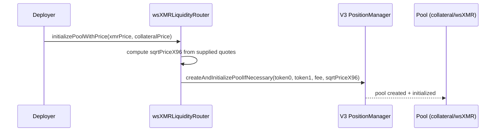
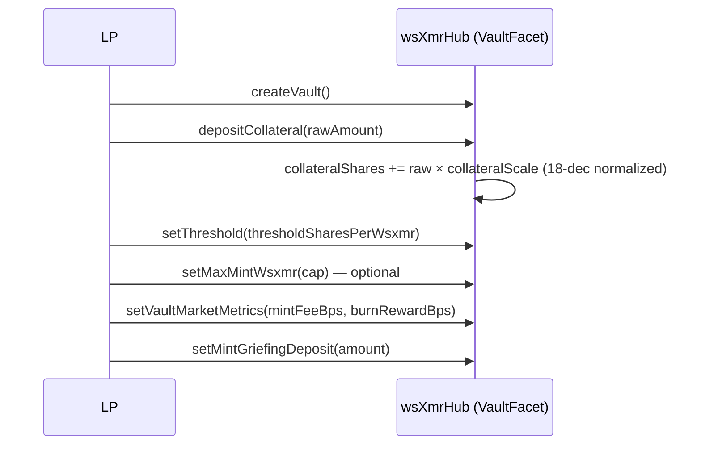
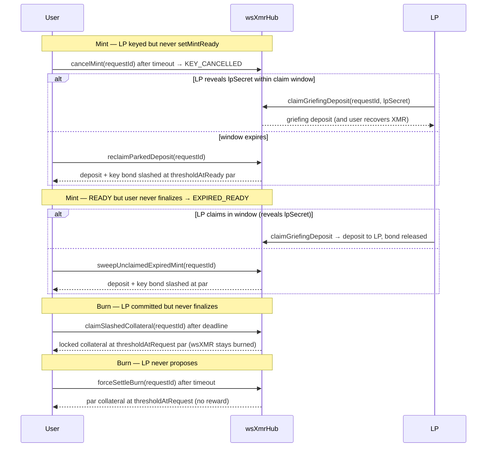

# wsXMR Sequence Diagrams — Oracle-Free Protocol

All flows are oracle-free: no actor, message, or check reads an external price feed.
Every "price-like" quantity below is the vault's LP-declared **threshold**
(normalized collateral per 1e8 wsXMR), a negotiated counterparty term, or the
pool's own `slot0`.

## Contents

1. [Pool Initialization](#1-pool-initialization)
2. [Vault Setup](#2-vault-setup)
3. [Mint Flow (XMR → wsXMR)](#3-mint-flow-xmr--wsxmr)
4. [Burn Flow (wsXMR → XMR)](#4-burn-flow-wsxmr--xmr)
5. [Kick → Dutch Auction Liquidation](#5-kick--dutch-auction-liquidation)
6. [Co-LP Open / Unwind](#6-co-lp-open--unwind)
7. [Timeout & Slash Paths](#7-timeout--slash-paths)

---

## 1. Pool Initialization

Deploy-time only. The deployer seeds the pool's starting tick from live
off-chain quotes — a deploy-time market price, not a protocol oracle.



## 2. Vault Setup



The threshold is the vault's solvency line: free collateral must cover
`(debt + pending) × threshold / 1e8` for the vault to keep accepting mints
and to stay economically solvent on its own declared terms.

## 3. Mint Flow (XMR → wsXMR)

```mermaid
sequenceDiagram
    participant U as User
    participant H as wsXmrHub (MintFacet)
    participant LP as LP Server
    participant X as Shared XMR Address

    U->>H: initiateMint(lpVault, xmrAmount, wsxmrAmount, claimCommitment, userPubKey){griefingDeposit}
    H->>H: capacity: (debt+pending+mint) × threshold ≤ free collateral
    H-->>U: requestId

    LP->>H: provideLPKey(requestId, lpSpendPub, lpViewPub)
    H->>H: pendingDebt += wsxmrAmount

    LP->>LP: shared address = user pub + LP pub (2-of-2)
    U->>X: send XMR
    LP->>X: verify deposit (check_tx_key / view-only scan)

    LP->>H: setMintReady(requestId)
    H->>H: thresholdAtReady = vault.threshold
    H->>H: lock key bond = par × 110% (par = wsxmr × threshold/1e8)

    U->>H: finalizeMint(requestId) — reveals secret
    H->>H: verify scalarMultBase(secret) == claimCommitment
    H-->>U: mint wsXMR (minus mintFeeBps → LP)
    H->>H: release key bond; debt += wsxmrAmount; pendingDebt -= wsxmrAmount
    LP->>X: sweep XMR (secret + lpSecret = full spend key)
```

## 4. Burn Flow (wsXMR → XMR)

```mermaid
sequenceDiagram
    participant U as User
    participant H as wsXmrHub (BurnFacet)
    participant LP as LP Server

    U->>H: requestBurn(lpVault, wsxmrAmount, xmrAmount, secretHash, claimCommitment, pubs)
    H->>H: thresholdAtRequest = vault.threshold
    H->>H: lock ∝ par collateral (~1.3 × free × wsxmr/debt cap) + reward
    H->>H: burn user's wsXMR

    LP->>H: proposeHash(requestId, secretHash, lpPubs)
    LP->>LP: send XMR to user's destination
    U->>H: commitBurn / LP->>H: confirmMoneroLock
    LP->>H: finalizeBurn(requestId) — reveals secret
    H->>H: verify hash(secret) == secretHash
    H->>H: lockedCollateral → LP; reward → pendingReturns[user]
    H->>H: debt -= wsxmrAmount
    U->>H: withdrawReturns(collateralToken)
```

## 5. Kick → Dutch Auction Liquidation

```mermaid
sequenceDiagram
    participant K as Kicker
    participant H as wsXmrHub (LiquidationAuctionFacet)
    participant LP as Vault LP
    participant B as Bidder
    participant N as New LP (backstop)

    K->>H: kick(vault) {bond}
    H->>H: phase = GRACE; emit KickStarted

    alt LP responds during GRACE
        LP->>H: depositCollateral(any) OR repayDebt(any)
        H->>H: emit KickCancelled; bond → LP
    else grace expires
        K->>H: openAuction(vault)
        H->>H: settle in-flight burns; unwind co-LP positions
        H->>H: offeredCollateral = free collateral; phase = OPEN_DELAY → ACTIVE
        loop Dutch decay 100% → 5%
            B->>H: bid(vault) — pays full wsXMR debt
            H-->>B: X(t)% of offeredCollateral
            H->>H: surplus − kicker chip → reserve; X* ≤ 80% ⇒ wrongful kick, bond → LP
        end
    else no bids by auctionEnd
        H->>H: phase = FROZEN; bond → kicker back
        note over H: frozen vault never drains — only rescue paths
        K->>H: reauction(vault) — one retry of price discovery
        N->>H: backstopVault(oldVault) — healthy LP assumes debt + collateral
    end
```

## 6. Co-LP Open / Unwind

```mermaid
sequenceDiagram
    participant U as User
    participant H as wsXmrHub (CoLPFacet)
    participant R as LiquidityRouter
    participant P as V3 Pool

    U->>H: userOpenCoLP(lpVault, wsxmrAmount, collateralAmount, deadline)
    H->>H: capacity: free − (debt+pending) × threshold ≥ collateralAmount
    H->>R: mintConcentratedPosition(collateralAmount, wsxmrAmount, rangeBps, deadline, slipBps)
    R->>P: slot0() → current tick
    R->>R: tick bounds = tick ± rangeBps-equivalent, snapped to spacing
    R->>P: mint NFT position
    R-->>H: (tokenId, collateralConsumed, wsxmrConsumed)
    H->>H: deployedCollateral += consumed; deployedWsxmr += consumed
    H-->>U: emit CoLPDeployed(tokenId, collateralConsumed, wsxmrConsumed, rangeBps)

    U->>H: userUnwindCoLP(tokenId, deadline)
    H->>R: drainPosition(tokenId, slipBps)
    R->>P: burn liquidity; spot-derived slippage floor
    R-->>H: (collOut, wsxmrOut)
    H->>H: collateral leg → vault collateralShares; wsXMR leg → pendingReturns[user]
```

## 7. Timeout & Slash Paths


